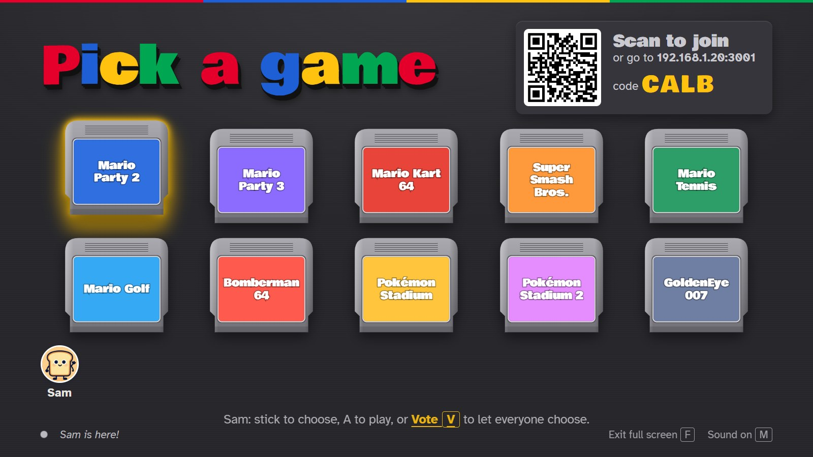
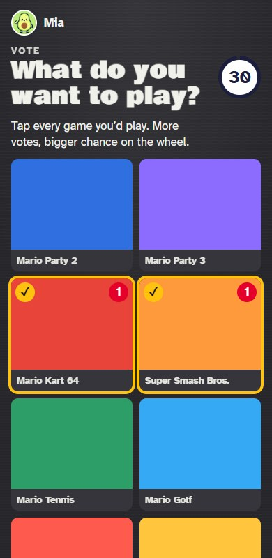
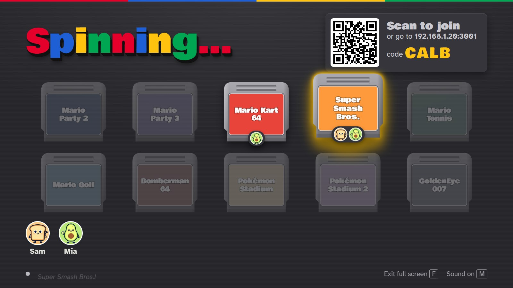
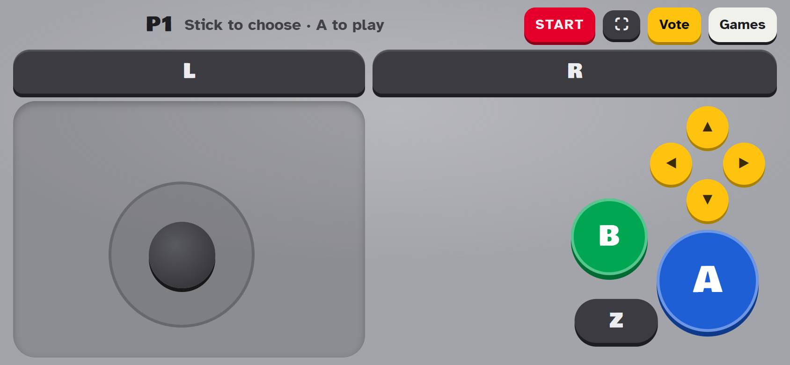
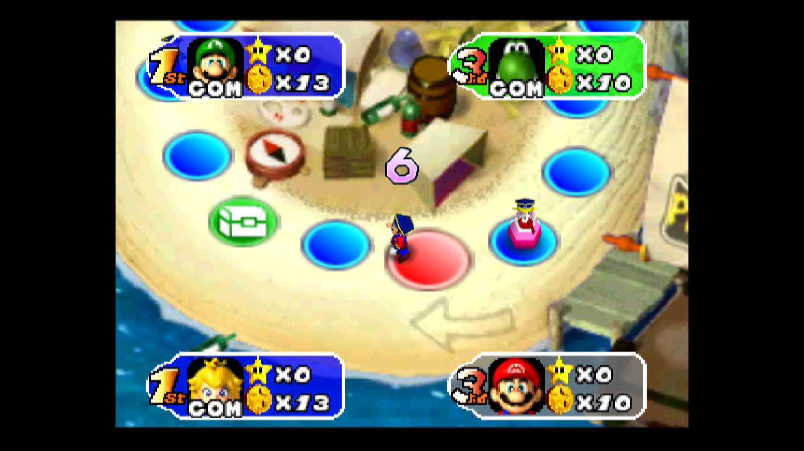

# Living Room 64

N64 games on the TV, with everyone's phone as the controller. No apps and no pairing: scan the QR code on the TV, pick a sticker, and you're player 1–4.

No games are included. You bring dumps of your own cartridges (see [Games](#games)).



## What it does

- **The real games.** The TV runs the original cartridges in [EmulatorJS](https://emulatorjs.org) (mupen64plus). Each phone is wired to its own controller port.
- **A controller made for two thumbs.** Stick under the left thumb, A, B and Z under the right, and L and R as wide strips along the top. Buttons follow your finger, so one thumb can rest on A and Z together or slide from B to A.
- **Pick a game three ways.** The VIP moves over the shelf with the stick and presses A. Or anyone starts a vote: everyone ticks the games they'd play, and the TV spins between them, weighted by votes. Or vote for nothing and let the spin pick anything.
- **Whose turn is it (Mario Party 2).** The TV reads the game's memory, so each phone shows "Your turn!" (and buzzes), plus its own coins and stars.
- **Freezes cost one turn, not the evening.** The TV saves at the start of every Mario Party 2 turn and notices when the emulator stops. The VIP can go back to a save, save by hand in any game, reset the console, or quit to the shelf.
- **Run the room from the TV.** Click ✕ on a sticker to remove a player. F toggles full screen, M mutes, and the arrow keys and Enter work on the shelf.

| Voting on a phone | The TV spins between the picks |
| --- | --- |
|  |  |





## Run it

You need [Node.js](https://nodejs.org) 18 or newer.

```sh
npm install
npm start
```

1. Put your ROM zips in `roms/` (see [Games](#games)).
2. On the computer that's plugged into the TV, open `http://localhost:3000/tv` in Chrome or Edge and click **Open the room**. Press **F** for full screen and keep that tab in front: browsers pause the emulator in background tabs.
3. Phones on the same Wi-Fi scan the QR code, or go to the address shown on the TV and type the room code.
4. The first player to join is the VIP and picks the game.

A laptop over HDMI works much better than a smart TV's built-in browser, which is too slow for N64 emulation. The emulator itself loads from the EmulatorJS CDN, so the TV computer needs internet on first load.

**Full screen on phones:** Android goes full screen and sideways on the first touch. iPhones can't do that from a web page; use Share → Add to Home Screen and open the controller from that icon.

## Games

This repo has no ROMs and no cover art. Dump your own cartridges and put the zips in `roms/`. [roms/README.md](roms/README.md) lists the file names the shelf looks for. The shelf shows only the games whose zip is there.

The list of games is in `public/js/packs/games.js`. To add one that isn't listed:

1. Put `roms/<id>.zip` in place.
2. Add an entry to `GAMES` with the same `id`, a title, a tagline and a colour.
3. Optionally, add a cover at `public/assets/covers/n64-<id>.webp`, 480×360. The top of the cartridge label works well. Without one, the cartridge shows the game's name on its colour.

The shelf fits five cartridges per row. ROMs and covers are ignored by git, so they stay on your machine.

### Reading Mario Party 2's memory

The phones know whose turn it is because the TV reads N64 RAM straight out of the emulator's WebAssembly memory. It finds RAM by searching for game code the console copies to `0x80000400` at boot. The addresses were found by comparing RAM dumps between turns. They only match **Mario Party 2 (Europe)**:

| Address | What |
| --- | --- |
| `0x800F71C7` | Slot of the player whose turn it is (0–3) |
| `0x800CCF05` | `2` while a board is being played |
| `0x800FB0C0` | 4 player slots of `0x34` bytes: port `+3`, character `+4`, flags `+7` (bit 0 = computer), coins `+8`, stars `+0xE` |

Other games and regions would need their own addresses in `games.js`.

## How it fits together

```
server.js              Static files, QR codes, and a WebSocket relay between the TV and the phones
public/tv.html         The TV: hub, shelf, vote and spin (js/tv.js)
public/play.html       The phone: join, sticker, controller, vote (js/phone.js)
public/n64.html        EmulatorJS page the TV embeds in an iframe
public/js/packs/n64.js Emulator host on the TV, RAM reader, saves, and the phone controller
public/js/packs/games.js  The game list
roms/                  Your game zips (not in the repo), served only from /roms/
```

All game logic runs in the TV's browser; the server only passes messages along. Phones keep their player id when they reconnect, and the TV takes its room back if it reloads.

There's also a set of party games (write-and-vote, a hidden-faker game, trivia, a describe-the-word game, and reaction mini-games) from before the switch to N64. They're hidden. Set `SHOW_PARTY_GAMES = true` in `public/js/packs/index.js` to bring them back.

## License

[MIT](LICENSE). The emulator, [EmulatorJS](https://github.com/EmulatorJS/EmulatorJS), is loaded from its CDN at runtime and has its own GPL-3.0 license.

Living Room 64 isn't affiliated with or endorsed by Nintendo. Nintendo 64 and the game titles mentioned are trademarks of their owners. Only use ROMs dumped from cartridges you own.
